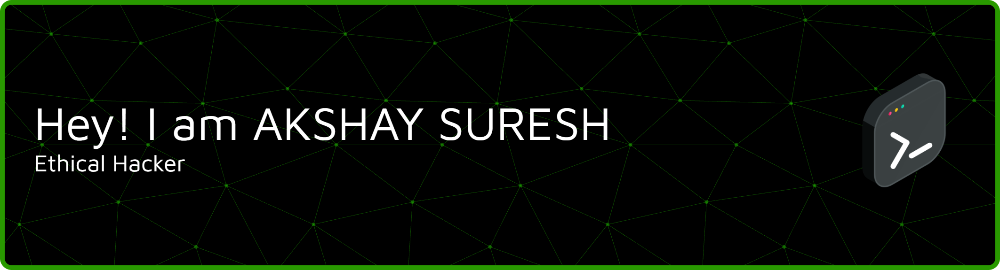

Aspiring Penetration Tester | Red Teaming | Web & Network Security | Ethical Hacking

- 🎓 Google Cybersecurity Certified  
- 🔐 Passionate about Ethical Hacking & Vulnerability Assessment  
- 👨‍💻 Projects: Phishing Detection System, Port Scanner, VAPT Labs  
- 🌐 Portfolio: https://akshayy-y.github.io/Portfolio/ 
- 📫 How to reach me: akshaysuresh441@gmail.com  

---

🔍 Featured Projects
Active-Directory-Attack-Lab

A simulated enterprise AD environment built to attack, covering Kerberoasting, AS-REP Roasting, Pass-the-Hash, ACL abuse, and DCSync/Golden Ticket — the full modern AD attack chain from initial foothold to domain compromise. Active Directory Kerberos Windows Server Mimikatz

RedTeam-Lab-Writeups

14+ writeups from authorized training labs and CTFs, each walked end to end: enumeration, exploitation, and root cause. Covers web application security, command injection, insecure deserialization, SSTI, XXE, privilege escalation, and steganography. CTF Web Exploitation Privilege Escalation

Wazuh-SOC-Lab

Built an isolated Wazuh SIEM lab and attacked it myself — Nmap recon, SSH brute force, EICAR malware, cron persistence — to see exactly what gets detected and what slips through. Knowing how detection works makes for better attacks. Wazuh MITRE ATT&CK Detection Evasion

Splunk-SIEM-Home-Lab

A Splunk-based SOC lab validating SSH brute-force detection end to end — log forwarding, indexing, and alerting. Built to understand the blue-team side of the attacks I run. Splunk SIEM Log Analysis

PhishGuard

A full-stack Django app that detects phishing emails in real time with a trained ML model, auto-blocks malicious senders, and runs sentiment analysis on every message. Python Django scikit-learn

## 🛡️ Cybersecurity Tools & Skills

  
  
  
  
  
  
  

🛠️ Skills & Tools

        

Offensive Security: Penetration Testing · Active Directory Attacks (Kerberoasting, Pass-the-Hash, DCSync) · Network Pentesting · Web Application Security (OWASP Top 10) · Reconnaissance Tools: Kali Linux · Nmap · Burp Suite · Metasploit · Hydra · SQLmap · Mimikatz/Rubeus Blue-Team Awareness: Wazuh · Splunk · MITRE ATT&CK · Log Analysis Programming & Scripting: Python · Bash · PHP · JavaScript Systems & Networking: Linux · Windows Server / AD · TCP/IP · DNS · HTTP/HTTPS · Git

## 🌐 Connect with me

---

## 💻 Development Skills

